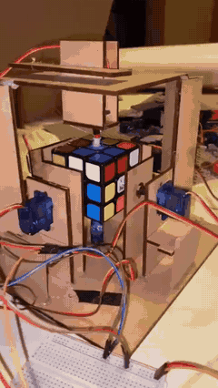
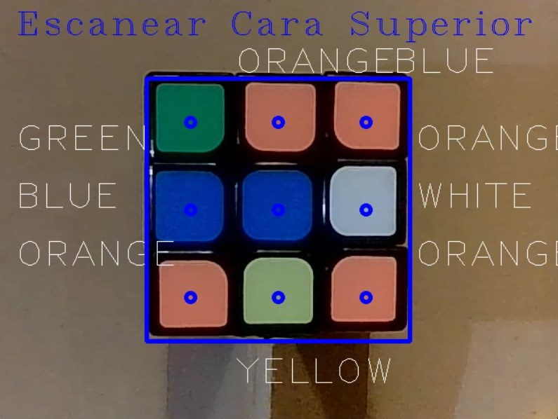

# Resolución del cubo Rubik con visión artificial

Programa en **Python** que reconoce el estado de un cubo Rubik con una **cámara** y **OpenCV**, y calcula su solución con el **algoritmo de Kociemba**. Además construimos un **prototipo robótico** en MDF con **servomotores** controlados por **Arduino** para girar las caras del cubo.

> Proyecto universitario — Universidad San Francisco de Quito (USFQ).

**Resultado:** solución correcta en el **95 %** de los casos.

<p align="center">
  
  &nbsp;&nbsp;
  
</p>

## Cómo funciona

1. **Captura:** la cámara muestra en pantalla un recuadro con una cuadrícula de 3×3 puntos de muestreo, uno por cada casilla de la cara.
2. **Detección de color:** cada punto se convierte al espacio **HSV**.
   - El **matiz (H)** clasifica la casilla en rojo, naranja, amarillo, verde o azul.
   - Una **saturación (S)** baja (≤ 65) identifica el blanco.
3. **Escaneo de las 6 caras:** el programa pide en orden la cara superior, derecha, frontal, inferior, izquierda y trasera. Con la tecla `Esc` se guarda cada cara.
4. **Cadena de estado:** los 54 colores se traducen a la notación de caras `U R F D L B` que usa Kociemba.
5. **Solución:** `kociemba.solve()` devuelve la secuencia de movimientos para resolver el cubo, por ejemplo `R U R' U' …`.

| Color | Cara (notación Kociemba) |
|---|---|
| Azul | U (arriba) |
| Rojo | R (derecha) |
| Blanco | F (frente) |
| Verde | D (abajo) |
| Naranja | L (izquierda) |
| Amarillo | B (atrás) |

## Uso

```bash
pip install -r requirements.txt
python rubik_solver.py
```

El programa usa la cámara con índice `1` (`cv2.VideoCapture(1)`). Si tienes una sola cámara, cámbialo a `0`. Escanea las caras con el cubo orientado según la tabla de colores. Los umbrales de color pueden necesitar ajustes según la iluminación.

## Estructura

| Archivo | Contenido |
|---|---|
| `rubik_solver.py` | Detección de colores con OpenCV y solución con Kociemba |
| `docs/media/` | Video y GIF del prototipo, y captura de la detección de colores |

## Tecnologías

Python · OpenCV · NumPy · Kociemba · Visión artificial (HSV) · Arduino · Servomotores

## Autor

**Matías Loayza Correa** — Ingeniero Mecánico, USFQ  
[Portafolio](https://mleo22d.github.io) · [LinkedIn](https://www.linkedin.com/in/matias-loayza)
